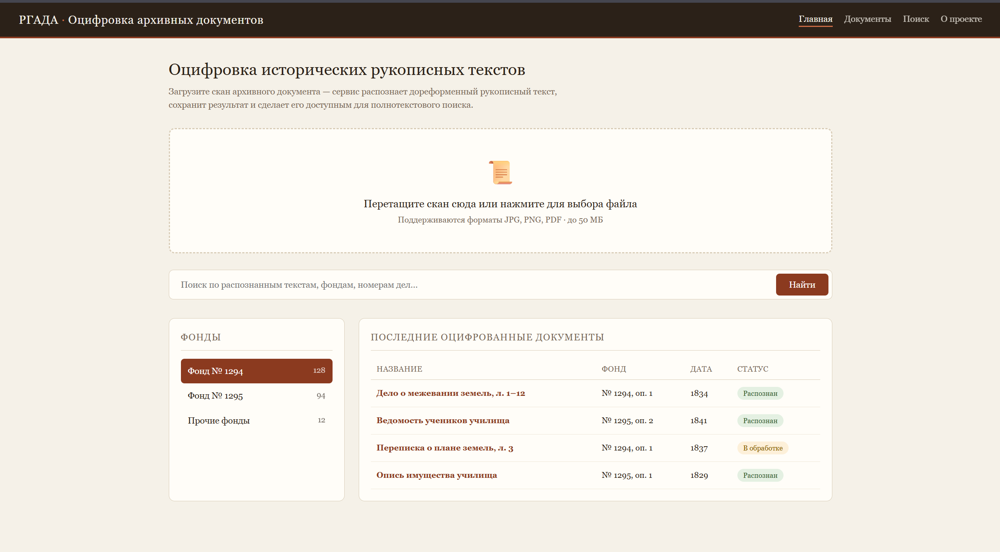

# Оцифровка исторических рукописных текстов на русском дореформенном языке

Веб-сервис для оцифровки и систематизации архивных рукописных текстов из РГАДА. Будут оцифрованы архивные документы константиновского межевого училища (фонд РГАДА №1294, №1295), представляющие интерес для кафедры истории МИИГАиК.

<!-- Значки состояния, если есть: тесты, последняя версия. Значок тестов GitHub Actions:
[](https://github.com/Ingur-5967/RecognizeHistoricalText/actions/workflows/tests.yml) -->


<!-- Снимок экрана или схема. Текст в квадратных скобках – описание для тех, кто картинку не видит. -->

## Возможности

- все находится в разработке

- что в работе – со ссылкой на issue: [#12](../../issues/12);

- в работе - Написать первую главу отчета по анализу литературы: [#3](https://github.com/Ingur-5967/RecognizeHistoricalText/issues/3)

- в работе - Исследовать методы OCR (Optical Character Recognition);

- в работе - Собрать и проанализировать данные для машинного обучения;

- в работе - Предобработка изображений для машинного обучения;

- в планах - Загрузка изображений и PDF-сканов архивных документов;

- в планах - Полнотекстовый поиск по оцифрованным документам;

- в планах - Просмотр распознанного текста с привязкой к исходному изображению;

- в планах - Экспорт результата в .docx и .pdf;

- в планах - Поддержка пакетной обработки сканов.

## Быстрый старт

<!-- Команды, которые можно скопировать, и что должно получиться. Проверьте: человек не из команды
должен запустить проект только по этому разделу. -->

```bash
git clone https://github.com/Ingur-5967/RecognizeHistoricalText.git
cd RecognizeHistoricalText
# команда установки зависимостей
# команда запуска
```

Результат:

```text
Оцифрованный файл в формате .docx, .pdf с распознанными символами загруженного изображения дореформенного рукописного текста.
```

## Требования

- язык и версия: Python 3.10 или новее

## Структура проекта

| Путь | Что там |
|------|---------|
| `src/` | исходный код |
| `tests/` | тесты |
| `docs/` | документация, снимки экрана |

## Как мы работаем

Подзадачи – в Issues, спринты – в вехах, доска – в Projects: https://github.com/users/Ingur-5967/projects/1.
Правила веток, коммитов, pull request и определение готовности – в [CONTRIBUTING.md](CONTRIBUTING.md).

## Команда

| Участник | Роль | За что отвечает |
|----------|------|-----------------|
| [@Ingur-5967](https://github.com/Ingur-5967) | Frontend-разработчик | Разработка веб-интерфейса, ведение документации |
| [@holaamigoo](https://github.com/holaamigoo) | ML-разработчик | Подготовка данных для обучения, обучение модели машинного обучения, ведение документации |

## Лицензия

<!-- Например: [MIT](LICENSE). Лицензиям посвящено отдельное занятие курса. -->
